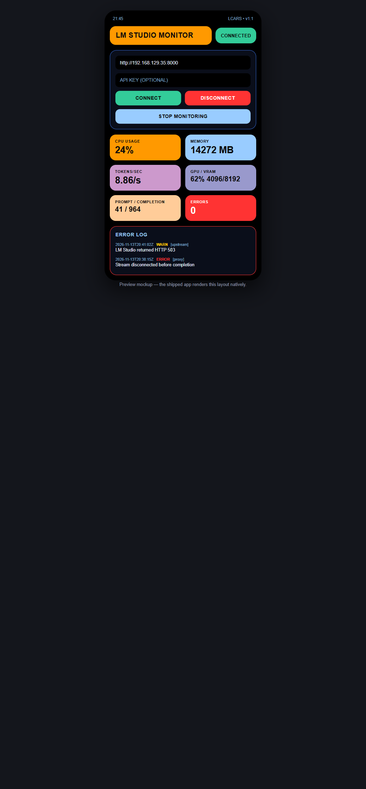

# DashboardLMStudio - Android Monitoring App


## Overview
An Android dashboard for viewing metrics from a reachable LM Studio-compatible server.

## Preview



The app uses a Star Trek LCARS-style theme: black background, rounded "padd" blocks in the classic orange / blue / purple / red palette, with the connection status shown as a coloured pill. Metric cards refresh every five seconds; the error log sits in its own panel below.

The same dashboard is also available as a **webpage** — the bridge serves it at `http://<PC-LAN-IP>:8000/`, and the standalone file lives at `companion-metrics-server/src/metrics_server/web/index.html` for opening from anywhere. See the [web dashboard](companion-metrics-server/README.md#web-dashboard) section.

## Download the app

- [Download the latest debug APK](https://github.com/npequeux/LMStudio-Dashboard/releases/latest/download/com.example.dashboardlmstudio-Signed.apk)
- [Download the companion metrics server ZIP](https://github.com/npequeux/LMStudio-Dashboard/releases/latest/download/DashboardLMStudio_MetricsServer.zip)
- [Latest release notes](https://github.com/npequeux/LMStudio-Dashboard/releases/latest)
- [All releases](https://github.com/npequeux/LMStudio-Dashboard/releases)
- [GitHub Actions builds](https://github.com/npequeux/LMStudio-Dashboard/actions/workflows/build.yml) — temporary debug APK artifacts may require signing in to GitHub.

The direct links always point at the latest published GitHub Release. These APKs are debug-signed and are for testing only. Each release's debug key may differ; uninstall an older debug build before installing a new one if Android rejects the update. The app requires Android 8.0 (API 26) or later.

## Install on Android

1. Open the [latest release](https://github.com/npequeux/LMStudio-Dashboard/releases/latest) on your Android device and download `com.example.dashboardlmstudio-Signed.apk`.
2. If prompted, allow your browser or file manager to install unknown apps. On Android 8+, this permission is under **Settings → Apps → Special app access → Install unknown apps**.
3. Open the downloaded APK and tap **Install**.
4. After installation, you can turn off the install-unknown-apps permission again.

These APKs are sideloaded; they are not distributed through Google Play. Only install APKs from releases you trust.

## Connect and use

1. Start the companion metrics bridge on the PC and make it reachable from the phone. Keep the PC and phone on the same trusted network, and allow TCP port 8000 through the PC firewall for Private networks.
2. The server URL is prefilled as `http://<PC-LAN-IP>:8000` (the app ships with an example address); change it to the PC running the bridge. The app remembers the URL after you connect.
3. Tap **Connect**, then **Start Monitoring** after the connection succeeds. Metrics refresh every five seconds. Use **Stop Monitoring** to pause polling and **Disconnect** to release the connection.
4. If the bridge sets `BRIDGE_API_KEY`, enter the same key in the **Bridge API key** field before connecting.
5. View CPU, memory, GPU, token-speed, prompt/completion, and error metrics returned by the bridge.

The Android app calls `GET /health` and `GET /api/v1/metrics` on the bridge. LM Studio itself does not implement those routes, which is why pointing the app directly to LM Studio produces an unexpected-endpoint response. The bridge proxies LM Studio's model/inference API and supplies the dashboard's metrics routes. Its source and run instructions are in `companion-metrics-server/` in this repository.

Token metrics come from two sources. The bridge listens to LM Studio's live inference diagnostics (`lms log stream`), so predictions made in the LM Studio desktop app are captured while the bridge is running; and at startup the bridge seeds the dashboard from the most recent prediction stored in LM Studio's local conversation history, so the last prediction is visible even when the bridge was started afterwards. Inferences routed through the bridge are measured directly, and streaming requests get `stream_options.include_usage` added so they are measured too. For a **live** rate during a response, the bridge also streams LM Studio's runtime log (`lms log stream --source runtime`) and reads the engine's `tg = X t/s` timing lines, exposing `liveTokensPerSecond`; the dashboard shows that value whenever it is newer than the last completed prediction. The `logMonitor` and `runtimeLogMonitor` fields in `/api/v1/metrics` report the two listeners (`running`, `retrying`, `unavailable`, or `disabled`). Plain HTTP is used for this local-network setup; do not expose it to public networks.

### PC requirements

- Install [LM Studio for Windows, macOS, or Linux](https://lmstudio.ai/download) and start its API server from the **Developer** tab. The bridge defaults to `http://127.0.0.1:1234/v1` (same machine as LM Studio); configure `LM_STUDIO_URL` if LM Studio runs elsewhere.
- Run the Python companion service from the `companion-metrics-server` folder in this repository, or download and extract the [companion metrics ZIP](https://github.com/npequeux/LMStudio-Dashboard/releases/latest/download/DashboardLMStudio_MetricsServer.zip). Its default upstream is `http://127.0.0.1:1234/v1`.
- Enter the bridge URL (`http://<PC-LAN-IP>:8000`) in the Android app. LM Studio must be reachable at the configured upstream address.

### Install the companion metrics service on Windows

1. Download and extract `DashboardLMStudio_MetricsServer.zip`, or use the `companion-metrics-server` folder from the repository.
2. Install [uv](https://docs.astral.sh/uv/getting-started/installation/) if it is not already installed.
3. Open PowerShell in the extracted `companion-metrics-server` folder and install dependencies:

   ```powershell
   uv sync
   ```

4. Start LM Studio's API server. By default the bridge reaches it at `http://127.0.0.1:1234/v1` on the same PC. If LM Studio runs on another machine or port, set `LM_STUDIO_URL` in PowerShell before starting the bridge:

   ```powershell
   $env:LM_STUDIO_URL = "http://<PC-LAN-IP>:1234/v1"
   ```

5. Start the bridge:

   ```powershell
   uv run uvicorn metrics_server.app:app --host 0.0.0.0 --port 8000
   ```

6. Allow TCP port 8000 through Windows Firewall for **Private networks** only. Keep the bridge running while using the Android app.
7. In the app, connect to `http://<PC-LAN-IP>:8000` (replace the placeholder with the PC's LAN address). Do not enter LM Studio's `:1234/v1` address in the app; that address is for the bridge's upstream connection.

If using Python/pip instead of uv, from the companion folder run `py -m venv .venv`, then `.\.venv\Scripts\python -m pip install -e .`, and launch with `.\.venv\Scripts\python -m uvicorn metrics_server.app:app --host 0.0.0.0 --port 8000`.

## Features
- Live CPU, memory, GPU, token-speed, and prompt/completion metric cards
- Error count and error log display
- Connection to a bridge by base URL, with optional bearer API key
- Start/stop monitoring and disconnect controls
- Five-second dashboard refresh

## Architecture
```
┌─────────────────────────────────────────┐
│        MainPage (.NET MAUI)             │
│  ┌──────────┬──────────┬──────────────┐ │
│  │   CPU    │ Memory   │ Tokens/sec   │ │
│  │  Card    │ Card     │   Card       │ │
│  └──────────┴──────────┴──────────────┘ │
│  ┌─────────────────────────────────────┐│
│  │       Error Log (CollectionView)    ││
│  └─────────────────────────────────────┘│
└─────────────────────────────────────────┘
              │ HttpClient + System.Text.Json
              ▼
┌─────────────────────────────────────────┐
│        Metrics bridge (FastAPI)          │
│  GET /                      (web dashboard)             │
│  GET /health                            │
│  GET /api/v1/metrics  (log + runtime monitors)      │
│  GET /api/v1/errors                     │
│  POST /v1/chat/completions  (proxy)     │
└─────────────────────────────────────────┘
              │ httpx
              ▼
┌─────────────────────────────────────────┐
│            LM Studio API                 │
│  GET /v1/models                         │
│  POST /v1/chat/completions              │
└─────────────────────────────────────────┘
```

## Building from source

### Prerequisites

- .NET 10 SDK with the .NET MAUI workload (`dotnet workload install maui-android`)
- JDK 17 or later
- Android SDK (API 36). If dotnet cannot find it, set `ANDROID_HOME` to your SDK folder (e.g. `%LOCALAPPDATA%\Android\Sdk`) or pass `-p:AndroidSdkDirectory=<path>`.
- A server reachable from the Android device and exposing the routes described below

The MAUI app lives in `app/`. Build a debug APK with:

```bash
dotnet build -f net10.0-android -c Release app/DashboardLMStudio.csproj
```

The APK is written to `app/bin/Release/net10.0-android/com.example.dashboardlmstudio-Signed.apk`; it is debug-signed and intended for testing.

## GitHub releases

Each version tag builds the app and publishes a GitHub Release with the APK and the companion metrics server ZIP. **`v1.0` was the first stable release; `v1.1` added the live token rate, `v1.2` the review fixes, and `v1.2.1` hardened the log monitors.** The APK is debug-signed — there is no release keystore — so it is not suitable for Play Store distribution. A production release would need a persistent keystore and GitHub Actions secrets.

## CI builds

- [Build workflow](https://github.com/npequeux/LMStudio-Dashboard/actions/workflows/build.yml) builds the .NET MAUI APK and runs the Python bridge tests on pushes and pull requests.
- Version `v*` tags create a GitHub Release with the APK and the companion metrics server ZIP; pushes and PRs only run the checks.

## API endpoints

| Endpoint | Purpose |
| --- | --- |
| `GET /` | LCARS web dashboard served by the bridge |
| `GET /health` | Connection check (open even when a bridge API key is set) |
| `GET /api/v1/metrics` | CPU, memory, token speed, errors, model in use, `logMonitor`, `runtimeLogMonitor`, `serverLogMonitor`, `liveTimingLines`, `liveTokensPerSecond`, `lastUsageAt` |
| `GET /api/v1/errors` | Error list (declared in the client, not used by the monitoring screen) |
| `GET /v1/models`, `GET /api/v0/models` | Proxied to LM Studio (not used by the monitoring screen) |
| `POST /v1/chat/completions`, `POST /api/v0/chat/completions` | Proxied to LM Studio (not used by the monitoring screen) |

The monitoring screen probes `/api/v1/metrics` for both connectivity and data; it reads the error list from that same response.

The server URL is prefilled with an example LAN address; change it to the PC running the bridge. The app remembers the URL after you connect.

## Dependencies
- **.NET MAUI 10** - cross-platform UI
- **HttpClient + System.Text.Json** - REST API client and JSON parsing

## License
MIT License - See LICENSE file for details.
