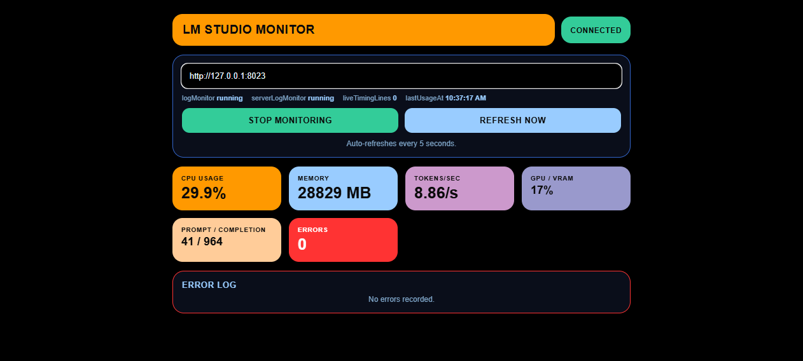

# DashboardLMStudio Metrics Bridge

A small FastAPI service for the Android DashboardLMStudio app. It runs beside LM Studio on the PC, exposes the dashboard's metrics routes, and proxies model/inference API requests to LM Studio.

## Why this is needed

LM Studio's built-in OpenAI-compatible server does not implement this dashboard's `/health` or `/api/v1/metrics` endpoints. Pointing the Android app directly at LM Studio therefore returns an unexpected-endpoint/404 response. Point the Android app at this bridge instead; the bridge handles those endpoints and forwards `/v1/models` and `/v1/chat/completions` to LM Studio.

## Web dashboard

The bridge serves a Star Trek LCARS-themed dashboard at `GET /` — open `http://<PC-LAN-IP>:8000/` in any browser, no Android app required. It polls `/api/v1/metrics` every five seconds and shows the same metric cards, monitor status, and error log as the app.



The page is a single self-contained file at `src/metrics_server/web/index.html`. Open it directly (double-click, or `file://…`) and type the bridge URL into the **BRIDGE URL** field — the bridge sends `Access-Control-Allow-Origin: *`, so it works from any origin. The URL and API key are remembered in `localStorage`.

The status line shows the **model in use** (`modelIdentifier` from the last prediction, falling back to the model LM Studio currently has loaded) plus the monitor states; hover the model name for its architecture, quantization, and context length.

If `BRIDGE_API_KEY` is set, the page prompts for the key and sends it as a bearer token. `/health` and the dashboard shell stay open, but `/api/v1/metrics` and the proxy stay protected.

## Requirements

- Python 3.11 or later
- [uv](https://docs.astral.sh/uv/) (recommended), or Python with pip
- [LM Studio](https://lmstudio.ai/download) installed and its local server running on the PC

By default the bridge connects to LM Studio at `http://127.0.0.1:1234/v1` (the same machine). Start the API server in LM Studio's **Developer** tab. If LM Studio runs elsewhere, set `LM_STUDIO_URL` before starting the bridge. `LM_STUDIO_API_KEY` is optional and is forwarded as a bearer token when set.

## Install and run on Windows

**Easiest:** extract the release ZIP and double-click `start.bat` in the extracted folder. It changes into the right directory, installs dependencies with `uv`, and starts the bridge on port `8000`. Leave the window open while using the dashboard.

If you prefer the command line, open PowerShell in the extracted folder—the one containing `pyproject.toml`. The ZIP is flat, so this is the folder you see immediately after extraction. Verify you are in the correct directory:

```powershell
Test-Path .\pyproject.toml
```

It must return `True`. If it returns `False`, change directory into the extracted `companion-metrics-server` folder before continuing. Running `uv run uvicorn metrics_server.app:app` from the **parent** folder fails with `ModuleNotFoundError: No module named 'metrics_server'` — that is a wrong-directory error, not a bridge bug. The launcher handles this for you. Install the dependencies:

```powershell
uv sync
```

Alternatively, use Python's built-in virtual environment and pip:

```powershell
py -m venv .venv
.\.venv\Scripts\python -m pip install -e .
```

Start the bridge so the Android phone can reach it over the LAN:

```powershell
uv run uvicorn metrics_server.app:app --host 0.0.0.0 --port 8000
```

If you installed with pip instead of uv, run `\.\.venv\Scripts\python -m uvicorn metrics_server.app:app --host 0.0.0.0 --port 8000`.

If LM Studio is not at its default address, set it first:

```powershell
$env:LM_STUDIO_URL = "http://<LM-STUDIO-IP>:1234/v1"
uv run uvicorn metrics_server.app:app --host 0.0.0.0 --port 8000
```

Keep the terminal open while using the dashboard. Allow TCP port `8000` through the PC firewall for **Private networks** if Windows asks. Do not expose the bridge or LM Studio server directly to the public internet; this bridge currently has no client authentication.

To find the PC's LAN IPv4 address, run `ipconfig` and use the IPv4 address of the active Wi-Fi/Ethernet adapter. In the Android app, enter the bridge URL, not LM Studio's port:

```text
http://<PC-LAN-IP>:8000
```

For example: `http://PC-LAN-IP:8000`.

## Metrics and proxy behavior

- `/health` returns a successful health response for the Android app's connection check.
- `/api/v1/metrics` returns CPU percentage, system RAM used (MB), latest token/s rate, retained error count, and error entries.
- `/api/v1/errors` returns the retained error entries.
- `/v1/models` and `/v1/chat/completions` proxy to LM Studio.

CPU and system memory are measured on the PC. Token metrics come from LM Studio's diagnostics stream, its runtime log, and predictions routed through the bridge. `lms log stream --source model --stats --json` records each finished prediction's token speed and prompt/completion counts; at startup the bridge seeds the dashboard from the most recent prediction in LM Studio's conversation history. Streaming proxy requests get `stream_options.include_usage` added so they are measured too. The snapshot exposes `logMonitor`, `runtimeLogMonitor` and `serverLogMonitor` states, `liveTimingLines`, `modelIdentifier`/`modelPath` and `loadedModel`, plus `liveTokensPerSecond`. The runtime monitor supplies the live rate; the server-log tailer is only a fallback. Proxy errors are kept in an in-memory rolling log (up to 100 entries); restarting the bridge clears it.

## Configuration

| Environment variable | Default | Purpose |
| --- | --- | --- |
| `LM_STUDIO_URL` | `http://127.0.0.1:1234/v1` | LM Studio API base URL; `/v1` is supported |
| `LM_STUDIO_API_KEY` | unset | Optional bearer token for LM Studio |
| `BRIDGE_API_KEY` | unset | Bearer token required by the bridge's data and proxy routes. `/health` and `/` stay open. Set this before binding to `0.0.0.0` on a shared network. |
| `ENABLE_API_DOCS` | unset | Set to `1` to expose `/docs` and `/openapi.json`; disabled by default. |
| `ENABLE_LM_STUDIO_DEBUG_LOGS` | unset | Optional fallback: raise LM Studio's engine log level to Debug so the file-based tailer can also see timing lines. Not normally needed — the runtime log stream works without it. |
| `CORS_ORIGINS` | `*` | Comma-separated origins allowed to call the bridge from a browser (the standalone web dashboard). Restrict, e.g. `http://PC-LAN-IP:8000`, if the bridge is exposed beyond your LAN. |

### Live token rate

LM Studio only reports a prediction's *final* token speed when the response finishes, but it also streams the engine's own log lines through `lms log stream --source runtime`. Those lines contain `slot print_timing: … tg = X t/s`, which the bridge reads live and exposes as `liveTokensPerSecond`. The dashboard shows that value whenever it is newer than the last completed prediction, so the card ticks **during** a response instead of only jumping at the end.

Watch `runtimeLogMonitor` (`running`/`retrying`/`unavailable`) and `liveTimingLines` (climbs as timing lines arrive). No LM Studio settings change is required. If the CLI stream is unavailable, `ENABLE_LM_STUDIO_DEBUG_LOGS=1` additionally raises LM Studio's engine log level so the file-based fallback can pick the lines up.

## Verify and test

With the bridge running, these URLs should respond:

- `http://127.0.0.1:8000/health`
- `http://127.0.0.1:8000/` (LCARS dashboard)
- `http://127.0.0.1:8000/api/v1/metrics`
- `http://127.0.0.1:8000/v1/models` (requires LM Studio to be running)

Run the automated tests with:

```powershell
uv sync --extra test
uv run pytest -q
```
